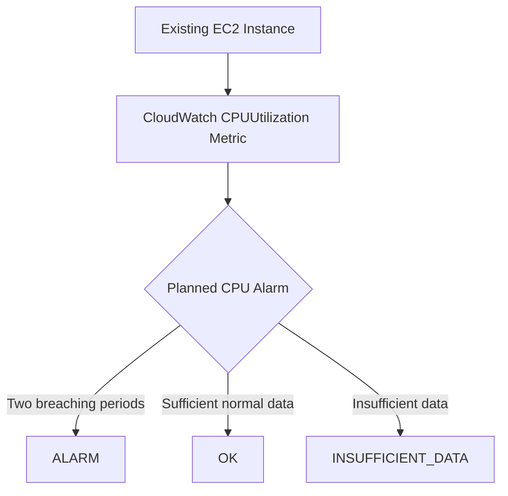
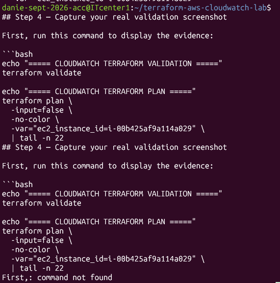

# AWS CloudWatch Terraform Lab

## Project Status

**PLAN ONLY — NOT DEPLOYED**

This project demonstrates using Terraform to plan an Amazon CloudWatch CPU utilization alarm for an existing EC2 instance.

## AWS Environment

- Region: us-east-1
- EC2 instance: i-00b425af9a114a029
- Instance type: t3.micro
- Instance state during validation: stopped

## Architecture

This diagram represents the planned architecture, not a deployed alarm.

## Planned Alarm Configuration

| Setting | Value |
|---|---|
| Alarm name | terraform-ec2-high-cpu-alarm |
| Metric | CPUUtilization |
| Namespace | AWS/EC2 |
| Threshold | Greater than 80% |
| Period | 300 seconds |
| Evaluation periods | 2 |
| Statistic | Average |
| Missing data | missing |
| Notification actions | None configured |

## Validation Results

Terraform validation passed.

Terraform plan:

`Plan: 1 to add, 0 to change, 0 to destroy.`

No `terraform apply` was performed.

## Evidence

See [Validation Evidence](docs/validation-evidence.md).

## Security and Cost

- Never publish AWS credentials, private keys, or Terraform state files.
- Review screenshots before publishing.
- CloudWatch alarms may incur charges when deployed.
- The existing EC2 instance was not started or modified.

## Future Improvements

- Deploy the alarm after authorization.
- Configure SNS notifications.
- Test alarm state changes.
- Add a CloudWatch dashboard.

These improvements have not been implemented.
