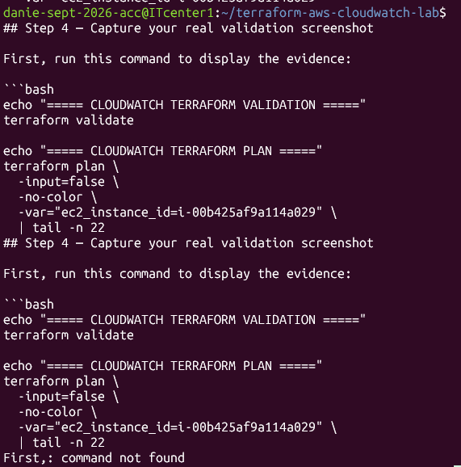

# AWS CloudWatch Terraform Validation Evidence

## Project Status

**PLAN ONLY — NOT DEPLOYED**

## Verified AWS Environment

- Region: us-east-1
- EC2 instance: i-00b425af9a114a029
- Instance type: t3.micro
- Instance state: stopped

## Terraform Validation

Command: `terraform validate`

Observed result:

`Success! The configuration is valid.`

## Terraform Plan

Command:

`terraform plan -input=false -no-color -var="ec2_instance_id=i-00b425af9a114a029"`

Observed result:

`Plan: 1 to add, 0 to change, 0 to destroy.`

## Planned AWS Resource

- Resource: aws_cloudwatch_metric_alarm.cpu_high
- Alarm name: terraform-ec2-high-cpu-alarm
- Metric: CPUUtilization
- Threshold: Greater than 80%
- Evaluation periods: 2
- Period: 300 seconds

## Verified

- Existing EC2 instance identified using AWS CLI.
- Terraform configuration validated successfully.
- Terraform plan completed successfully.
- One CloudWatch alarm planned.

## Not Verified

- CloudWatch alarm deployment.
- Actual alarm monitoring.
- Alarm state transitions.
- Alarm notifications.

## Screenshot

## Conclusion

Terraform successfully planned one CloudWatch CPU utilization alarm. No CloudWatch alarm was deployed.
